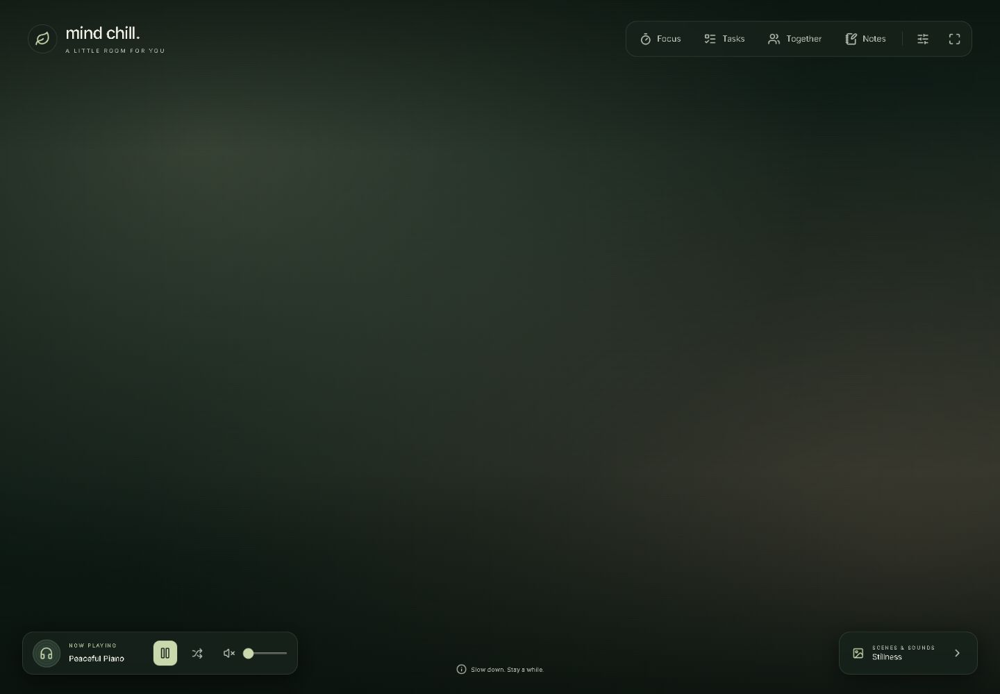
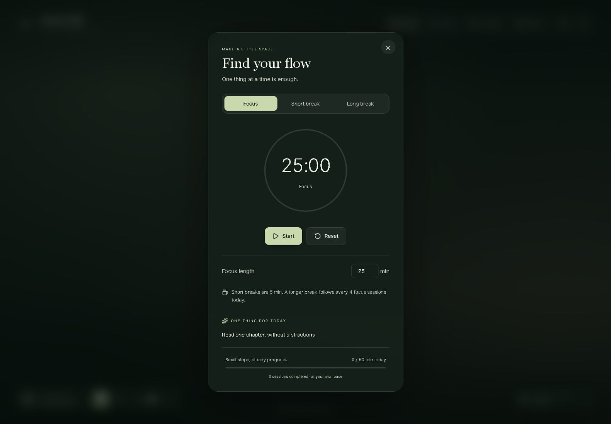
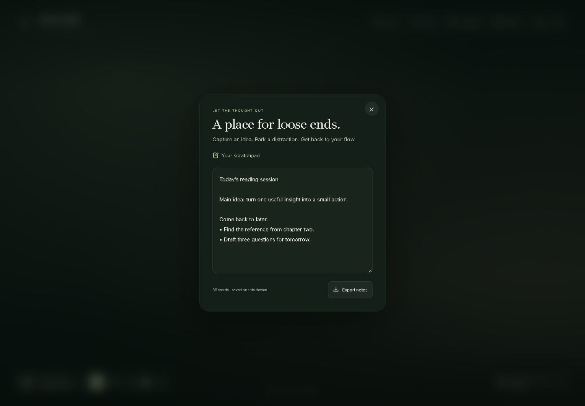
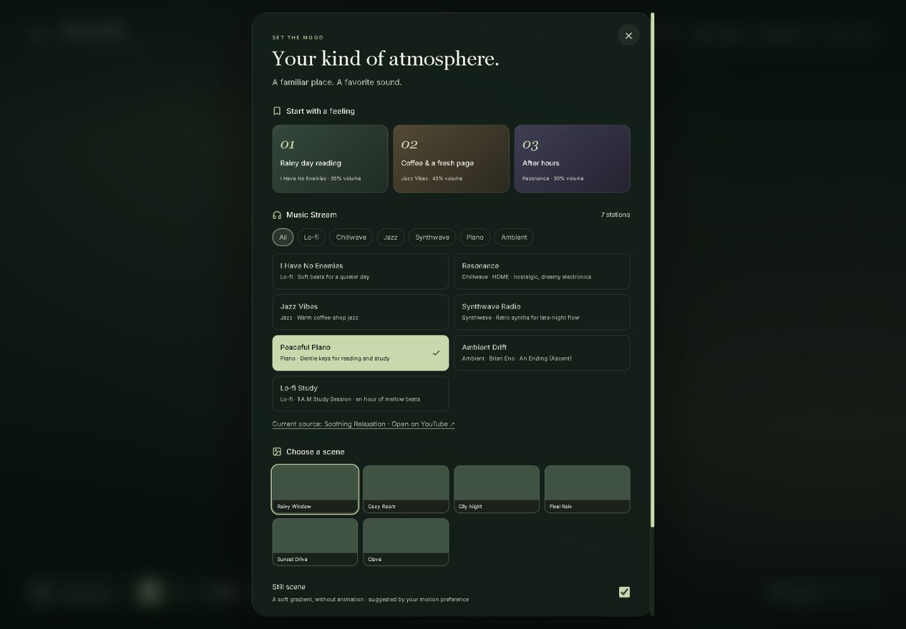
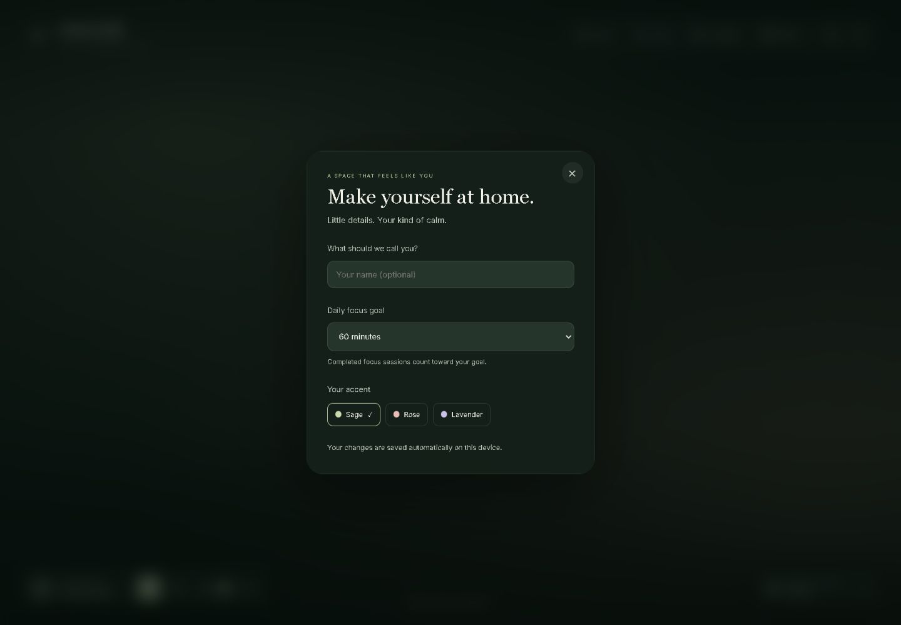

<div align="center">

# Mind Chill

**A little room for you.**

Music, a cozy backdrop, and the tools to focus on one thing at a time.

[](LICENSE)


[User guide](docs/USER_GUIDE.md) · [Development](docs/DEVELOPMENT.md) · [Troubleshooting](docs/TROUBLESHOOTING.md) · [Contributing](CONTRIBUTING.md)

</div>



Mind Chill is a browser workspace for studying, working, reading, or unwinding. The center stays open for the scenery; focus, tasks, and notes live in panels you open when you need them. No account is required.

## What's inside

| Tool | What it does |
| --- | --- |
| Music | Seven YouTube selections across lo-fi, chillwave, jazz, synthwave, piano, and ambient, with genre filters, volume, mute, shuffle, source links, and retry controls. |
| Scenes & sounds | Six GIF backdrops, a still gradient scene, three starter presets, and up to six named presets that remember your scene and audio settings. |
| Focus | Adjustable 1–120 minute focus sessions, 5-minute short breaks, 15-minute long breaks, a session intention, and daily progress. |
| Tasks | Add, complete, filter, and remove tasks. Use the target icon to turn an active task into your focus intention. |
| Notes | An autosaving scratchpad for ideas and distractions, with a word count and plain-text export. |
| Personalization | Optional display name, daily focus goal, and sage, rose, or lavender accents. |
| Together | One-to-one study calls using PeerJS, with room codes and microphone/camera controls. |
| Workspace | Responsive layouts, fullscreen, keyboard shortcuts, and focus-managed dialogs. |

### A closer look

<table>
  <tr>
    <td><br /><strong>Focus on one thing</strong></td>
    <td><br /><strong>Park a thought</strong></td>
  </tr>
  <tr>
    <td><br /><strong>Find your atmosphere</strong></td>
    <td><br /><strong>Make it yours</strong></td>
  </tr>
</table>

Screenshots show the current UI with sample content and the still scene enabled. [See tasks and mobile views →](docs/USER_GUIDE.md)

## Run locally

Install Node.js and npm. This checkout was verified with **Node.js 25.1.0 and npm 11.6.2**; these are the tested versions, not a declaration of the minimum supported versions.

```bash
git clone https://github.com/Sij4n/MindChill.git
cd MindChill
npm ci
npm start
```

Open [localhost:3000](http://localhost:3000), then click the welcome screen or press **Enter**. A browser may require a separate press of **Play** before music starts.

The development command is **`npm start`**. There is currently no `npm run dev` script. Stop the server with **Ctrl+C** in its terminal.

### Commands

| Command | Purpose |
| --- | --- |
| `npm start` | Run the development server. |
| `npm run build` | Create the production files in `build/`. |
| `npm run lint` | Check JavaScript and JSX with ESLint. |
| `npm test` | Run tests in interactive watch mode. |
| `npm test -- --watchAll=false --runInBand` | Run the regression suite once. |

See [development setup](docs/DEVELOPMENT.md) for changing ports, the source structure, and deployment notes.

## A simple focus session

1. Open **Scenes & sounds** at the bottom right and pick music or a starter preset.
2. Open **Tasks**, add a task, and choose its **target icon** to use it as your intention.
3. Set your focus length and press **Start**. Close the panel to return to the scenery; the timer continues.
4. Capture stray thoughts in **Notes**. Completed focus sessions count toward the daily goal in **Focus**.

Breaks wait for you to press Start. A long break follows every fourth completed focus session that day.

## Keyboard shortcuts

| Key | Action |
| --- | --- |
| `Space` | Play or pause music |
| `M` | Mute or unmute music |
| `G` | Move to the next backdrop and enable animation |
| `P` or `C` | Toggle Focus |
| `T` | Toggle Tasks |
| `F` | Toggle fullscreen where supported |
| `Escape` | Close the standard panel currently in focus |

Shortcuts are ignored while typing or using inputs, buttons, links, or dialogs. The Together room has its own Close/Leave controls.

## What is saved

Preferences, tasks, notes, presets, session intention, focus length, daily goal, and completed-session history are stored in the browser's **local storage**. They stay in that browser and origin; there is no account sync.

The **current countdown resets on a page refresh**. Closing its panel keeps it running. Export important scratchpad notes before clearing browser storage or moving to another browser.

Music and animated scenes need an internet connection. YouTube videos can become unavailable or block embedding; use the recovery controls or another station. The [music source audit](MUSIC_SOURCES.md) records the last embedded-playback checks. Together needs camera/microphone permission and a suitable browser/network connection.

## Documentation

- [User guide](docs/USER_GUIDE.md) — using the panels, presets, goals, tasks, notes, and Together.
- [Development](docs/DEVELOPMENT.md) — setup, architecture, local data, tests, and production builds.
- [Troubleshooting](docs/TROUBLESHOOTING.md) — music, backdrops, timers, storage, and study-call issues.
- [Screenshot guide](docs/screenshots/README.md) — current captures and how to refresh them.
- [Music sources](MUSIC_SOURCES.md) — checked links and source-update rules.
- [Project status](PROJECT_REVIEW.md) — implemented behavior and remaining work.

## Credits and license

Created by [Sijan Pradhan](https://github.com/Sij4n). Application code is licensed under [MIT](LICENSE).

YouTube music, GIFs, and other third-party media remain the property of their respective owners. Their inclusion does not transfer their rights under this project's code license. Source attribution is available in the music panel and catalog.
