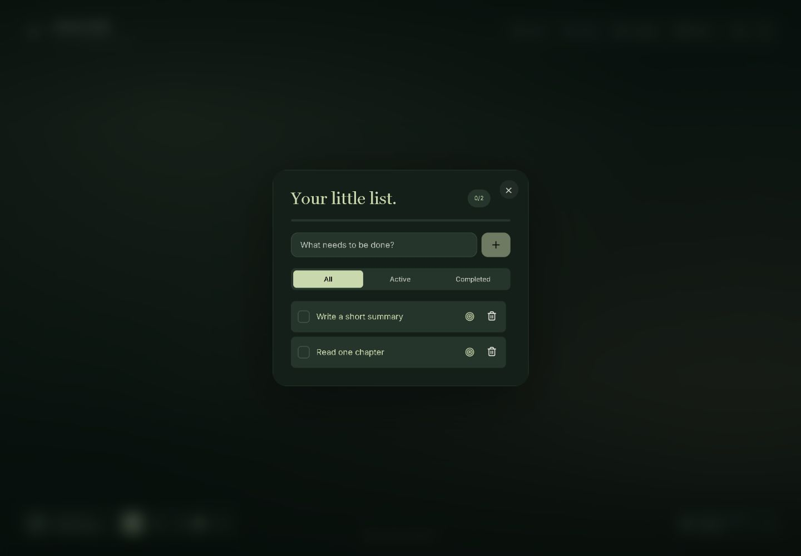
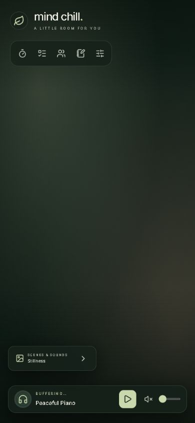
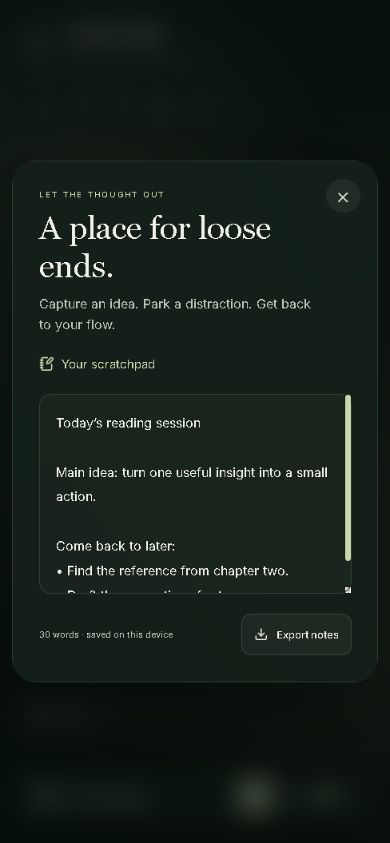

# User guide

[← README](../README.md)

## Find your way around

The center of the workspace is intentionally open. Use **Focus**, **Tasks**, **Together**, and **Notes** in the upper toolbar. The sliders icon opens personalization. The music player is at the bottom left; **Scenes & sounds** is at the bottom right on desktop and above the player on mobile.

On narrow screens, toolbar labels become icons. Their accessible names still identify the tools. Some desktop controls, including the fullscreen button and music shuffle button, are hidden on mobile.

## Music and scenery

Open **Scenes & sounds** to browse the current seven music selections. Filter by genre or use **All** to see everything. The selected station is highlighted. The player reports connecting, buffering, playing, and error states.

- **Play/Pause** controls music; **Mute** preserves the previous volume setting.
- **Shuffle station** chooses a different music selection, not a different backdrop.
- **Current source** opens the selected music on YouTube.
- The arrow beside the current scene, or `G`, moves to the next backdrop.
- Clicking the background itself does not change the scene.

If YouTube cannot play a selection, use **Retry playback**, **Next station**, or **Open on YouTube**. Videos may have different regional or embedding restrictions even when their watch pages exist.

### Still scenes and reduced motion

**Still scene** shows a soft gradient instead of a GIF. A browser preference for reduced motion makes this the initial default when no scene preference is saved. Selecting a GIF or using Next scene explicitly enables animation. The interface also reduces its own animations when reduced motion is requested.

If a GIF fails to load, the gradient remains available and the scene panel offers retry/another scene. These images are hosted externally; a scene label does not guarantee that its remote media will remain unchanged.

### Presets

The three starter presets combine a scene, music, and volume. To keep your own setup:

1. Select a station and backdrop, then adjust volume, mute, and still-scene settings.
2. Enter a name under **Your saved corners** and press **Save**.
3. Select that saved name later to restore the combination.

You can keep up to six personal presets, with names up to 40 characters. The trash icon removes a saved preset. Presets do not save tasks, notes, focus lengths, or accent colors. Scroll inside the panel to reach the saved-corners section.

## Focus sessions

Open **Focus** or press `P`/`C` while focus is on the workspace.

1. Choose **Focus**, **Short break**, or **Long break**.
2. Set a focus length of 1–120 minutes while the timer is stopped.
3. Add an intention under **One thing for today**, then press **Start**.
4. Use **Pause** to keep the remaining time, or **Reset** to reset the current mode.

The focus length defaults to 25 minutes. Short breaks last 5 minutes; long breaks last 15. After a focus session finishes, the app prepares a short break, or a long break after every fourth focus completion that day. After a break, it prepares Focus again. Each prepared session waits for Start.

Closing the panel keeps the timer running and reveals a compact countdown near the header. Select that countdown to reopen Focus. The timer uses a deadline and catches up when a background tab becomes active.

**Refreshing or closing the page resets the active countdown.** Completed history and the chosen focus length remain saved. Switching timer modes discards the current countdown. Finishing a full focus session adds its duration to today's progress; paused, reset, and unfinished sessions do not count.

## Tasks and focus intentions

Open **Tasks** to add tasks, mark them complete, filter All/Active/Completed, and remove individual or completed items.

The **target icon** beside an unfinished task copies its text into the session intention and opens Focus. It does not start or reset the timer, and it does not automatically complete the task when the timer finishes. You can edit the intention independently afterward. Task text is limited to 300 characters; the intention uses its first 160 characters.

## Scratchpad notes

Open **Notes** to capture an idea or park a distraction. The scratchpad saves as you type in this browser and displays a word count. **Export notes** downloads a plain-text file named `my-focus-notes.txt`.

Notes are limited to 20,000 characters. Export important notes before clearing browser data; local storage is not a cloud backup.

## Personalization and daily goals

The sliders icon opens personalization:

- An optional name of up to 30 characters personalizes the settings-panel heading.
- Daily goals can be 15, 30, 60, 90, 120, 180, 240, or 480 focus minutes.
- Choose a sage, rose, or lavender accent. The screenshot below shows sage.

Today's completed sessions and minutes appear in the Focus panel. Days follow the browser's local date. Progress can exceed a goal; the progress bar fills at the goal. The app retains up to 1,000 completed-session records.

## Study together

1. Open **Together** and allow the camera and microphone if you want to use the room.
2. Share the room code displayed under **Your Code** with your study partner.
3. Your partner opens Together, enters your code, and presses the arrow to call.
4. Use the microphone/camera controls during the session. Close or Leave Session to exit.

This is a one-to-one PeerJS video room. It does not currently share the focus timer, tasks, or notes. Incoming calls are currently answered automatically when a local media stream is available. Camera setup, signaling, and network compatibility can fail; see [troubleshooting](TROUBLESHOOTING.md#study-calls).

## Keyboard and accessibility

See the [shortcut table](../README.md#keyboard-shortcuts). Standard panels trap keyboard focus, support Tab/Shift+Tab, close with Escape, and return focus to their opening control. The Together room uses separate controls and does not yet share all of this dialog behavior.

## On mobile

The same workspace and scratchpad on a 390-pixel-wide phone view:

  
  

## What stays between visits

Local storage keeps tasks, scratchpad text, completed-session history, focus length, intention, preferences, and presets. It does not keep the running countdown, open panel, playback position, or active video call. A different browser, device, port, or hostname uses a different storage origin.
